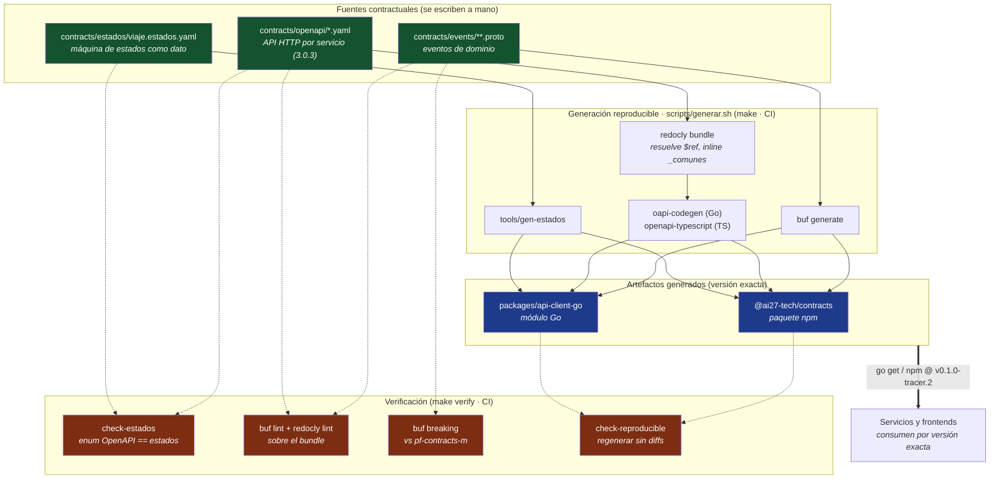

# pf-pkg-contracts

Fuente contractual **única y autoritativa** de la plataforma AI27: OpenAPI,
eventos (Protobuf) y la máquina de estados del `viaje`. De aquí se generan los
tipos y clientes de **Go** y **TypeScript**. Ningún servicio ni frontend declara
por su cuenta enums, clientes HTTP, sobres o tipos de control: los consume desde
aquí, por versión exacta.

> **Entregable cero (ADR 17).** Se entrega antes que cualquier servicio y se
> consume como dependencia versionada, no por ruta relativa. *"Los contratos son
> el artefacto, no el repositorio."*

| | |
|---|---|
| **Repositorio autoritativo** | `AI27-Tech/pf-pkg-contracts` |
| **Ramas** | `pf-contracts-m` (main) · `pf-contracts-d` (desarrollo) · `pf-contracts-q` (QA) |
| **Versión objetivo del tracer** | `v0.1.0-tracer.2` (prerelease SemVer inmutable — ADR 25) |
| **Historia técnica** | E0-T2 (`docs/historias-tecnicas/E0-fundamentos-plataforma.md`) |
| **Decisiones base** | ADR 19 (estados), ADR 22 (idioma), ADR 24 (recursos), ADR 25 (freeze), ADR 26 (revocación), ADR 27/28 (transporte) |

---

## Qué congela `v0.1.0-tracer.2`

La primera release cubre **sólo el tracer vertical**: la rebanada de arquitectura
que prueba las fronteras principales de extremo a extremo antes de desarrollar
horizontalmente las 30 HU. No es tracing distribuido ni telemetría.

Cubre: autenticación/sesión/alcance · catálogos del recorrido · creación y
aprobación del `viaje` · asignación de `unidad + custodios` · avance de estado y
ETA manual · auditoría y outbox · proyección de `reportes` · lectura autorizada
de hitos/ETA · revocación para HTTP y SSE.

**Fuera de esta release** (llegan en releases posteriores compatibles):
mensajería, emergencias/Reacción, y toda capacidad V2 (telemetría, posiciones,
señal, geocercas). Que una capacidad esté decidida no obliga a incluirla en
`tracer.2`.

---

## Estructura

```
contracts/
  estados/viaje.estados.yaml   Fuente ÚNICA de la máquina de estados (dato).
  openapi/                     Un spec por servicio del tracer + _comunes.yaml.
    identidad.yaml  catalogos.yaml  operacion.yaml  bff.yaml  reportes.yaml
  events/                      Eventos Protobuf + INVENTARIO.md.
    ai27/eventos/v1/*.proto
    registro.tipos.yaml        Registro legible por máquina de tipos de evento.
packages/
  api-client-go/               Módulo Go publicado. Todo commiteado.
    bff/ catalogos/ identidad/ operacion/ reportes/   clientes HTTP
    estados/ roles/ registro/                          datos del contrato
    eventos/ai27/eventos/v1/                           eventos Protobuf
  api-client-ts/               Paquete npm @ai27-tech/contracts. Todo commiteado.
tools/
  gen-estados/                 Genera estados -> Go y TS desde la fuente única.
  gen-roles/                   Genera el enum de roles -> Go y TS.
  gen-registro/                Genera el registro de eventos -> Go y TS.
  check-estados/               Verifica que el enum OpenAPI == fuente de estados.
  check-registro/              Verifica registro == .proto == INVENTARIO.md.
  openapi-codegen/             Fija la versión de oapi-codegen (reproducible).
  oasdiff/                     Fija la versión de oasdiff (breaking de OpenAPI).
scripts/
  generar.sh                   Único camino de codegen (lo usa make y CI).
  breaking-openapi.sh          oasdiff contra el último tag de tracer publicado.
  check-tags.sh                El árbol etiquetado trae los 9 paquetes del módulo.
  contract-tests.sh            Consumidor limpio del módulo Go + registro.
  manifiesto.sh                Escribe el manifiesto (tag/SHA/checksums).
  verificar-manifiesto.sh      El manifiesto congela el árbol actual, byte a byte.
```

---

## Cómo funciona

La idea central: **el contrato se escribe una vez, y el código se _genera_ desde
él** — para Go (backend) y TypeScript (frontends). Nadie escribe a mano un
cliente HTTP, un enum de dominio ni un tipo de evento; todos salen de la misma
fuente. Así un desarrollador de backend y uno de frontend usan tipos generados
del **mismo archivo** y no pueden discrepar sobre qué es un `viaje` o qué campos
lleva un endpoint.



**El flujo, paso a paso:**

1. **Escribes o cambias una fuente** en `contracts/` (un estado, un endpoint, un
   evento). Nunca editas el código generado.
2. **`scripts/generar.sh` regenera todo** por un único camino, con versiones de
   generador fijadas para que el resultado sea reproducible (mismo commit +
   toolchain → mismos bytes):
   - los estados van directo a Go y TS con `tools/gen-estados`;
   - cada spec de OpenAPI se **empaqueta** (`redocly bundle`, que inlina
     `_comunes.yaml`) y de ahí salen el cliente Go (`oapi-codegen`) y los tipos
     TS (`openapi-typescript`);
   - los eventos Protobuf se generan con `buf generate`.
3. **La verificación protege el contrato** (en `make verify` y en CI):
   `check-estados` confirma que el enum del spec de `operacion` no se desvíe de
   la fuente de estados; `redocly lint` valida los specs empaquetados y
   `buf lint` los eventos; `check-registro` confirma que el registro de tipos de
   evento, los `.proto` e `INVENTARIO.md` digan lo mismo; `breaking` y
   `breaking-openapi` impiden quitar o renumerar algo que un consumidor todavía
   lee (el primero contra la rama principal, el segundo contra el último tag
   publicado, porque una rama no es evidencia de freeze); `check-tags` confirma
   que el árbol etiquetado trae los nueve paquetes del módulo Go; y
   `check-reproducible` regenera y compara contra `HEAD`, fallando si alguien
   editó un artefacto a mano.
4. **CI publica una versión exacta.** Al empujar el tag `v*-tracer.*`, una sola
   ejecución genera los artefactos, escribe y **verifica** el manifiesto (tag,
   SHA y checksums de fuentes y artefactos), publica el módulo Go por su tag
   prefijado `packages/api-client-go/vX.Y.Z`, corre los **contract tests**
   (consumidor limpio que compila los nueve paquetes contra el tag ya
   empujado, más la consistencia del registro) y sólo entonces publica el
   paquete npm y crea el release.
5. **Los consumidores fijan esa versión exacta** — nunca `latest` ni una ruta
   local —, de modo que todos hablan el mismo contrato congelado.

Qué se versiona: **todo**, las fuentes y los artefactos generados. Desde
tracer.2 los clientes Go y TS se commitean (decisión de owner, 2026-10-02,
opción (a)), y por eso `check-reproducible` tiene efecto real: compara cada
artefacto contra su blob en `HEAD`, de modo que editar a mano un `*.gen.go` y
commitearlo se detecta en CI.

La razón por la que antes no se commiteaban era evitar que la fuente y su
artefacto divergieran en el árbol. El tag de `tracer.1` resolvió el módulo Go y
**no traía nada importable**, porque el artefacto viajaba en el workflow en vez
de en el tag. Congelar el contrato significa que lo que el consumidor resuelve
por versión esté versionado: los `*.gen.*` se commitean y nunca se editan a
mano; se cambia la fuente y se regenera.

---

## La máquina de estados es un DATO, con una sola fuente

`contracts/estados/viaje.estados.yaml` es la fuente canónica del enum del
`viaje` (ADR 19, reconciliado con el backbone de negocio DEC-005/013/032).
`tools/gen-estados` genera desde ella **tanto Go como TypeScript**, así que el
enum es idéntico en su origen. Nadie copia el enum.

- 13 estados de progreso, incluidos los de V2 **declarados e inalcanzables** en
  V1 (`PATRULLA_EN_CAMINO`), para que V2 no sea una migración de máquina de
  estados. `EN_BASE_CLIENTE` es un **alias histórico** de `EN_EMBARQUE` para leer
  filas legadas, no un estado nuevo.
- `INCIDENCIA` y `SIN_SEÑAL` **no son estados**: son condiciones **ortogonales**
  (`condicion_viaje`). Un viaje puede estar `EN_TRANSITO` *y* con `INCIDENCIA`
  abierta. `SIN_SENAL` es V2.
- El backbone es un **bucle multi-parada**: `EN_DESTINO → EN_DESCARGA →
  EN_TRANSITO` (más paradas) o `→ CERRADO` (última), con descarga opcional.

`make check-estados` verifica que el enum `EstadoViaje` del spec de `operacion`
coincida con esta fuente; CI falla si divergen.

---

## Sesión: dos superficies, a propósito

Hay **dos** superficies HTTP para sesión, y no es una inconsistencia:

- **`bff` — `/api/v1/sesion` (singular).** Superficie **pública** del portal:
  la sesión **propia del llamante** (login / refresh / logout del usuario
  actual). Un recurso, el suyo.
- **`identidad` — `/api/v1/sesiones` (plural).** Superficie **interna** del
  servicio dueño: la **colección** administrable de sesiones (emitir, refrescar,
  revocar por id, snapshot de revocación para reconstrucción).

`bff` no valida credenciales: delega en `identidad`, que es la fuente de verdad
de la revocación (evento `sesion.revocada`, ADR 26). Los dos specs las declaran
así de forma explícita.

> Esto cierra la tensión que `docs/PLAN-EJECUCION-V1.md` §9 marcaba entre las dos
> formas de la ruta de sesión. La forma queda congelada aquí.

---

## OpenAPI 3.0.3 (no 3.1)

Los specs usan **OpenAPI 3.0.3**, no 3.1, porque el generador de Go de la
plataforma (`oapi-codegen`) todavía no soporta 3.1.x. La nulabilidad se expresa
con el idiom de 3.0.3 (`nullable: true`, y `allOf` + `nullable` cuando el campo
es un `$ref`), no con `oneOf: [..., {type: null}]`. Cuando `oapi-codegen`
soporte 3.1 de forma estable, migrar es un cambio aditivo.

## Convención de idioma (ADR 22 / DEC-024)

Prosa y comentarios en **español (México)**. Identificadores técnicos en
**inglés**, **salvo los sustantivos de dominio**, que conservan su forma
canónica en español —también como ruta de API, nombre de evento o esquema—:
`viaje`, `sesion`, `catalogos`, `operacion`, `mensajeria`, `bitacora`,
`asignacion`, `custodio`, `incidencia`, `reportes`. Por eso las rutas son
`/api/v1/viajes` y los eventos `viaje.estado_cambiado`, no su traducción.

---

## Cómo se consume (por versión exacta)

Los consumidores **fijan la versión exacta** `v0.1.0-tracer.2`. Nadie consume
por `CONTRACTS_DIR`, rama mutable ni `latest`; eso sirve para experimentación
local, no es un release.

**Go** — se resuelve por el tag Git del módulo:

```
go get github.com/AI27-Tech/pf-pkg-contracts/packages/api-client-go@v0.1.0-tracer.2
```

> **Dos tags por release.** El módulo Go vive en el subdirectorio
> `packages/api-client-go/`, así que Go exige que su versión se etiquete con el
> prefijo de la ruta: `packages/api-client-go/v0.1.0-tracer.2`. El release usa
> además el tag limpio `v0.1.0-tracer.2` (npm, GitHub Release, manifiesto). CI
> crea el tag prefijado automáticamente al publicar; en el comando `go get` se
> escribe la versión sin prefijo — Go lo traduce al tag prefijado por sí solo.

**TypeScript** — paquete `@ai27-tech/contracts` publicado en GitHub Packages,
fijado a la versión exacta en `package.json`. `@ai27-tech/ui` permanece
independiente de los contratos de dominio.

---

## Generación y verificación

Requisitos: Go (toolchain del repo), Node + npx, `buf`. Todo se fija por versión
en CI para que el codegen sea **reproducible** (mismo commit + toolchain →
mismos bytes).

```
make generate            # genera todos los artefactos Go y TS
make verify              # lint + check-estados + check-registro + build/vet de Go
make check-reproducible  # falla si alguien editó a mano un artefacto generado
make check-tags          # el árbol etiquetado trae los 9 paquetes del módulo Go
make check-registro      # registro de eventos <-> .proto <-> INVENTARIO.md
make lint                # buf lint (eventos) + redocly lint (OpenAPI)
make breaking            # buf breaking contra pf-contracts-m
make breaking-openapi    # oasdiff contra el último tag de tracer publicado
make contract-tests      # consumidor limpio del módulo Go publicado + registro
make manifest            # escribe manifiesto/tracer.manifest.json
make verificar-manifiesto  # el manifiesto congela el árbol actual, byte a byte
```

CI (`.github/workflows/contracts.yml`):

- **verificar** (push/PR): `buf lint`, `buf breaking`, lint de OpenAPI,
  `breaking-openapi`, equivalencia estados↔OpenAPI, consistencia del registro,
  contenido del árbol etiquetado, codegen reproducible, build de Go, typecheck
  TS.
- **publicar** (tag `v*-tracer.*`): una sola ejecución genera, confirma que el
  codegen es reproducible, verifica el árbol etiquetado, escribe y verifica el
  manifiesto, publica el módulo Go (tag prefijado
  `packages/api-client-go/vX.Y.Z`), corre los contract tests, publica el paquete
  npm y crea el release.

El orden importa: **los contract tests corren antes de publicar el paquete npm**
(invariante 7 de ADR 25). Es lo que no se hizo en `tracer.1` y por eso se retiró:
el tag resolvía, pero no traía nada importable.

---

## Estado del freeze (F-01)

La **decisión** de ADR 25 está cerrada y el repositorio ya no está vacío. El
hallazgo crítico **F-01** se cierra con `v0.1.0-tracer.2`, que sustituye a la
prerelease retirada `tracer.1`. La diferencia no es de versión: `tracer.1` publicó
un tag cuyo módulo Go resolvía sin llevar los clientes generados dentro, así que
no había nada importable. `tracer.2` versiona los artefactos, verifica el árbol
etiquetado y corre los contract tests contra el tag antes de publicar nada más.

F-01 queda cerrado cuando, además del release, los consumidores fijen la versión
exacta. El tag lo publica el pipeline, no se crea a mano.

## Regla de evolución

Agregar es aditivo. Quitar o renumerar requiere un release de gracia
(expand/contract). Una corrección posterior **no** modifica `tracer.2`: publica
otra prerelease (`tracer.3`). Un sufijo de prerelease retirado no se reutiliza
jamás, aunque su contenido se repita.
